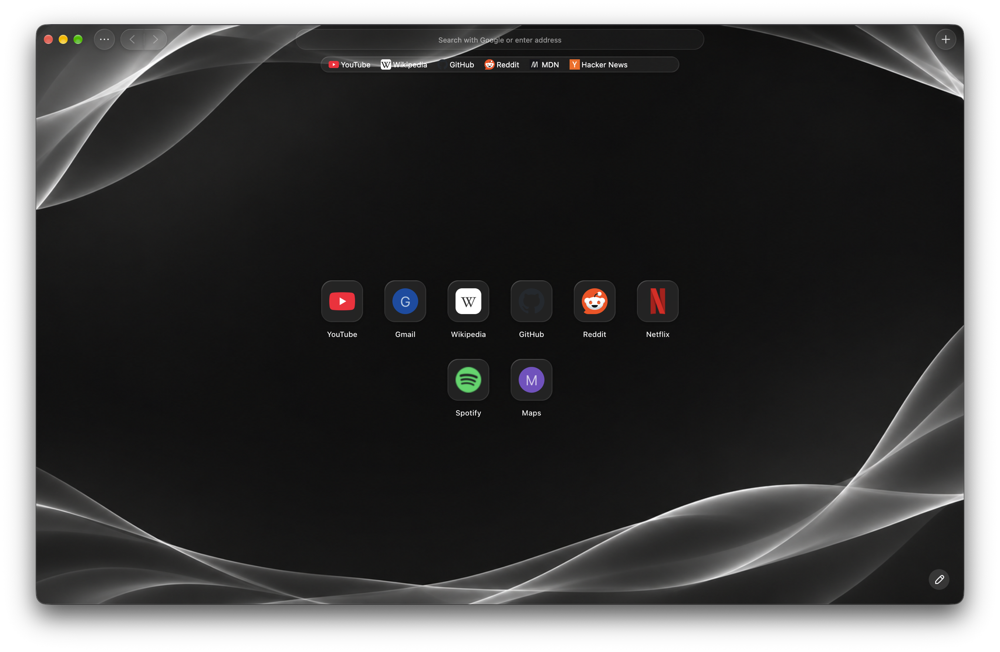
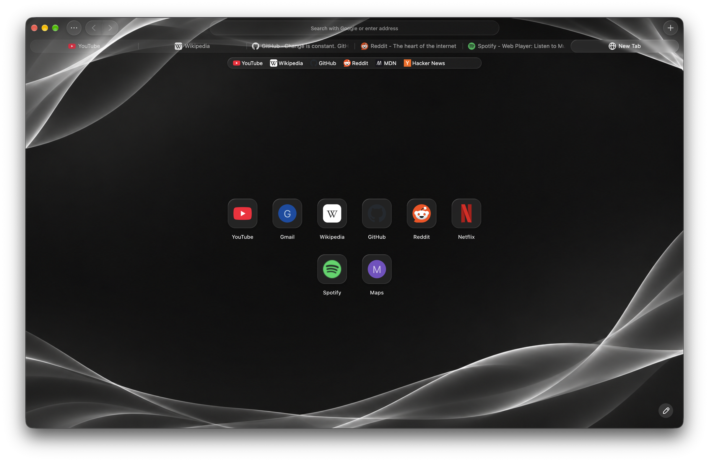
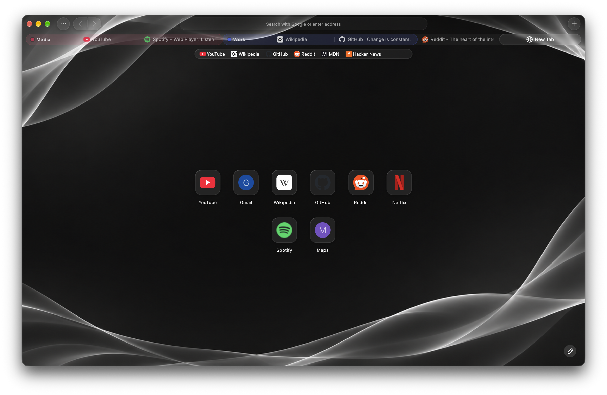
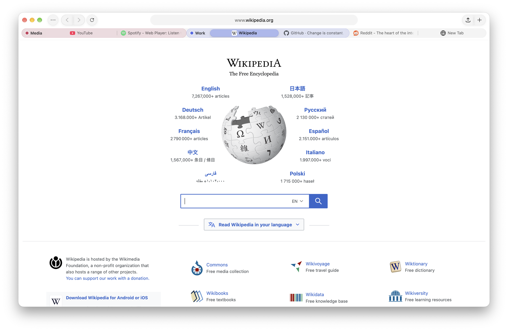
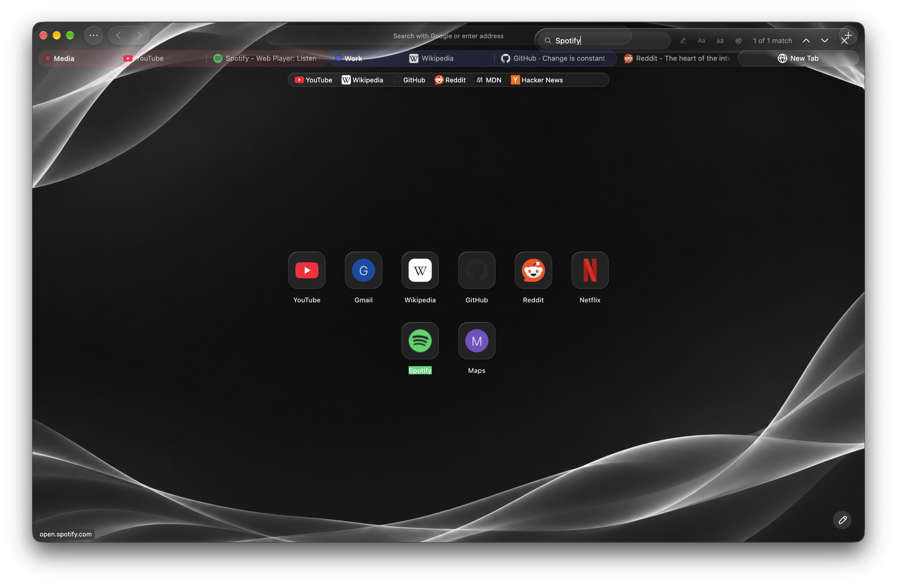

# Firefox Glass

A Safari-inspired glass theme for Firefox: a floating centred address bar, pill-shaped tabs, tinted tab-group capsules, a compact glass find bar and neutral grey menus. It also restyles the New Tab page, Settings, Library, Reader view and the PDF viewer. Works in light and dark mode.

Tested on Firefox 161 (macOS and Windows).

**Home page**

**With tabs**

**With tab groups**

**Light mode**

**Find bar**

## Install

### macOS
1. Open Firefox, go to `about:profiles`, and click **Open Folder** next to *Root Directory* of the profile in use.
2. Quit Firefox.
3. Copy the `macos/chrome` folder and `macos/user.js` into that profile folder. If a `chrome` folder already exists, rename it first to keep a backup.
4. Start Firefox.

### Windows
1. Open Firefox once, then close it.
2. Double-click `windows/Install.bat`. It closes Firefox, moves any existing theme aside as `chrome-backup-<date>`, backs up `user.js` and `prefs.js`, and installs the theme.
3. Start Firefox.

`user.js` turns on `toolkit.legacyUserProfileCustomizations.stylesheets` (needed for any CSS theme) and a few look-related settings. Every line is commented.

### Optional add-on
For toolbar colours that follow each website, install **Adaptive Tab Bar Colour** from addons.mozilla.org:
https://addons.mozilla.org/firefox/addon/adaptive-tab-bar-colour/
After installing, allow it to access website data (Add-ons and themes > Adaptive Tab Bar Colour > Permissions).

## Uninstall
Quit Firefox, then delete the `chrome` folder and `user.js` from your profile folder (or restore your backups).

## Notes
- Vertical tabs and the "expand sidebar on hover" modes are not supported.
- On macOS, right-click menus stay native; set System Settings > Appearance > Accent colour to Graphite for grey highlights.

## Credits and licence
- Made by [BuziS](https://github.com/BuziS).
- Based on [GWfox-T](https://github.com/akkva/GWfox-T) by akkva.
- Licensed under the Mozilla Public License 2.0 - see [LICENSE](LICENSE).
- Windows package includes the Inter font by Rasmus Andersson (SIL Open Font License, see `windows/chrome/fonts/Inter-LICENSE.txt`).
